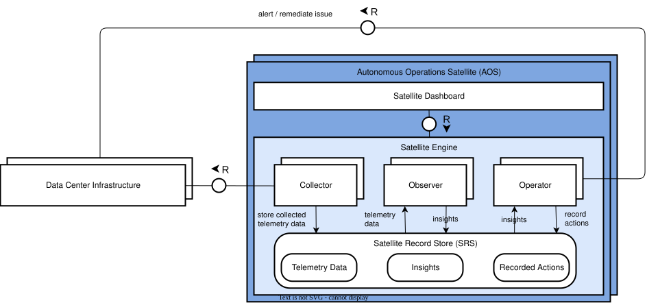
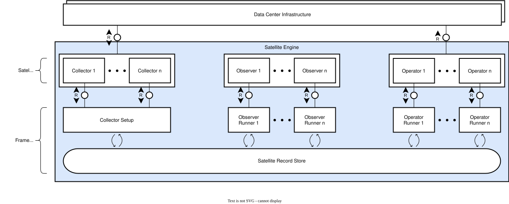
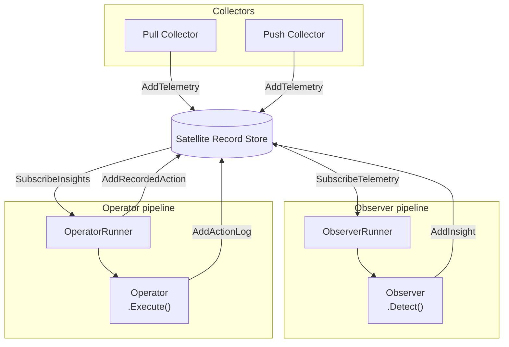

# Autonomous Operations Satellite Architecture



A [Collector](./collector.md) gathers telemetry data (push- or pull-based) and writes it to the store.
An [Observer](observer.md) subscribes to telemetry data (either all records or a subset of it using a filter).
When detecting a pattern, the Observer writes an Insight.
An [Operator](operator.md) subscribes to those insights, performs corresponding actions, and writes a log of this to Recorded Actions.

To reduce boilerplate code in the Collector, Observer, and Operator implementations, they are wrapped with a Runner by the framework and get a simplified interface to read/write to the Satellite Record Store.
The components register to the framework and a runner for each is instantiated.



## Satellite Record Store

The [store](./srs.md) is the only communication channel between components. No component imports another. All data exchange goes through the store.

Each component type receives a scoped store interface that exposes only the methods it is allowed to call. These interfaces are defined in their respective component sections below. The full `store.Store` interface — used only by runners — is shown in the [Runners](#runners) section.

## Scoped interfaces



1. **Collect** — a Collector gathers data from an external source and calls `CollectorStore.AddTelemetry` to write one or more `TelemetryRecord` entries to the store.
2. **Detect** — an `ObserverRunner` subscribes to `TelemetryRecord` entries matching the Observer's filter. For each new record, it calls `Observer.Detect`. If the Observer finds a pattern, it calls `ObserverStore.AddInsight` directly.
3. **Execute** — an `OperatorRunner` subscribes to `Insight` entries matching the Operator's filter. For each new Insight, it generates an `ExecutionID`, writes a `RecordedAction` with `StateStarted`, and calls `Operator.Execute`. The Operator calls `OperatorStore.AddActionLog` for each step. When `Execute` returns, the runner writes a second `RecordedAction` with `StateSuccess` or `StateFailed`.

The store interfaces are scoped/narrow interfaces of the store, as exposed to Collector, Observer, and Operator by the respective runner.

## Store wrappers

Components never receive the raw store. Each runner wraps it before passing it to the component. The wrapper adapts `store.Store` to the scoped interface and handles fields the component must not set itself.

| Wrapper                 | What it injects                                                                                                                                                         |
| ----------------------- | ----------------------------------------------------------------------------------------------------------------------------------------------------------------------- |
| `collectorstorewrapper` | Injects `ID` and `ReceivedAt` into every `AddTelemetry` call. Logs each write at `Debug`.                                                                               |
| `observerstorewrapper`  | Injects `ID`, `ObserverName` from `observer.Name()`, and `CreatedAt` into every `AddInsight` call. Logs each `AddInsight` call at `Info`.                               |
| `operatorstorewrapper`  | Injects `ID`, `ExecutionID` (generated by the runner), and `Timestamp` into every `AddActionLog` call. Logs each `AddActionLog` and `AddRecordedAction` call at `Info`. |

`ID`s are UUIDv7 IDs and timestamps are derived from the ID's embedded timestamp.

## Runners

The Core Framework starts each registered component at startup. For observers and operators, a dedicated runner owns the store subscription, the execution loop, and the writes the component must not perform directly. Collectors are started by a single startup loop — no per-collector runner is needed because `Setup` starts the collection mechanism and returns.

Each runner holds the full `store.Store` interface. Components receive only the scoped subset defined in their section.

```go
type Store interface {
    AddTelemetry(ctx context.Context, records []TelemetryRecord) error
    SubscribeTelemetry(ctx context.Context, filter TelemetryFilter) (<-chan TelemetryRecord, error)

    AddInsight(ctx context.Context, insight Insight) error
    SubscribeInsights(ctx context.Context, filter InsightFilter) (<-chan Insight, error)

    AddActionLog(ctx context.Context, log ActionLog) error
    AddRecordedAction(ctx context.Context, action RecordedAction) error

    QueryTelemetryByTime(ctx context.Context, q TelemetryTimeRangeQuery) (QueryResult[TelemetryRecord], error)
    QueryTelemetryFromCursor(ctx context.Context, q TelemetryCursorQuery) (QueryResult[TelemetryRecord], error)

    Close()
}
```

**Collector startup** — a single loop calls `collector.Setup(ctx, logger, s)` for each registered collector at startup. The logger is scoped with `component=collector` and `name=collector.Name()` before being passed. There is no per-collector runner. Each collector starts its own collection mechanism inside `Setup` and returns. The Core Framework does not manage any ongoing loop for collectors.

**ObserverRunner** — created for each registered observer. Calls `observer.Filter()` once at startup and opens a dedicated `SubscribeTelemetry` subscription with that filter. The store delivers only matching `TelemetryRecord` entries to this runner's channel. The runner calls `Observer.Detect` for each record, passing a `*slog.Logger` pre-scoped with `component=observer` and `name=observer.Name()`. On error, the runner logs the failure; no store write is made.

**OperatorRunner** — created for each registered operator. Calls `operator.Filter()` once at startup and opens a dedicated `SubscribeInsights` subscription with that filter. For each delivered `Insight`, the runner generates an `ExecutionID`, writes a `RecordedAction` with `StateStarted`, and calls `Execute`. After `Execute` returns, the runner writes a second `RecordedAction` with `StateSuccess` or `StateFailed` based on the returned error.

The runner is the only writer of `RecordedAction`. A component must not write `RecordedAction` directly.

## Registering components

Each component registers itself via an `init` function in its package.
This will instantiate the respective runners.

```go
// collectors/f5_pool_health.go
func init() { registry.RegisterCollector(NewF5PoolHealthCollector()) }

// observers/f5_pool_member_down.go
func init() { registry.RegisterObserver(NewF5PoolMemberDownObserver()) }

// operators/f5_reenable_pool_member.go
func init() { registry.RegisterOperator(NewF5ReenablePoolMemberOperator()) }
```

No changes to `main.go` are needed. Any `.go` file added to the component package is picked up automatically at compile time.

## Key design decisions

- **Store as the only communication channel** — no component imports another. All data exchange goes through the store.
- **Scoped store interfaces** — each component type receives only the store methods it is allowed to call (`CollectorStore`, `ObserverStore`, `OperatorStore`). Runners hold the full `store.Store`. The scoped interfaces are defined in the component packages and enforced at compile time via Go's `internal` package mechanism.
- **Explicit store writes** (see [ADR-001](/docs/adrs/0001-explicit-store-writes)) — components call write methods directly instead of returning values for the runner to write. This allows push-based collectors to write at the moment data arrives and allows operators to write action logs incrementally. If an operator crashes mid-execution, the partial action logs are still visible in the store.
- **`ExecutionID` links logs to outcomes** — the runner generates one ID per operator invocation and binds it to the scoped `OperatorStore` passed to `Execute`. The store injects it into every `ActionLog` entry; the runner uses the same ID for both `RecordedAction` records. A `Started` record with no terminal record indicates a crash during execution.
- **Attribute-based filtering** — `TelemetryFilter.Attributes` replaces source-specific fields. Components declare which key-value pairs they care about; the store does the matching. Identity comes from the data itself, not an out-of-band header.
- **Subscription-time filtering** — filters are evaluated inside the store's `Add*` methods before putting anything on the channel. Unmatched records never reach the subscriber.
- **Monotonic UUIDv7 IDs** — strictly increasing within a process and embedding the ingestion timestamp. Guarantee that cursor pagination never misses or duplicates records.
- **Drop-oldest back-pressure** — full subscriber channels drop the oldest entry, not the newest, and never block writes.
