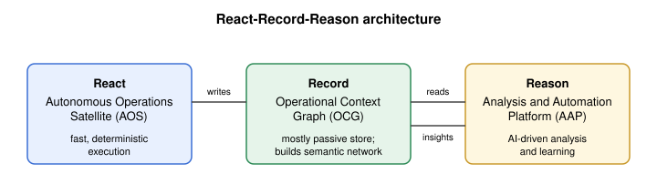
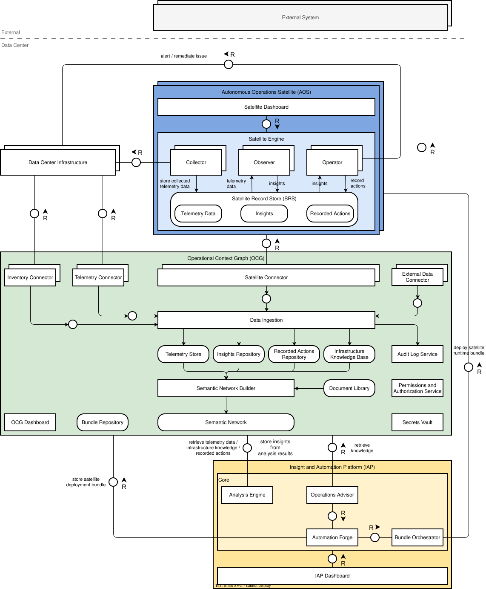

# Architecture

## React-Record-Reason

Autonomous Operations is structured according to a three-role architecture called **React-Record-Reason**. This separation of execution, knowledge, and analysis into three independent components is the central architectural decision of the system.

| Component                                  | Role                                                                                                                        | Deployment                        |
| ------------------------------------------ | --------------------------------------------------------------------------------------------------------------------------- | --------------------------------- |
| **Autonomous Operations Satellite (AOS)**  | Detects and remediates known issues in real-time using deterministic rules - no AI on the critical path                     | Bare-metal (always on, resilient, distributed) |
| **Operational Context Graph (OCG)**        | Central knowledge repository: telemetry, topology, runbooks, recorded actions, and a live semantic model of the data center | Kubernetes                        |
| **Insight and Automation Platform (IAP)** | AI-driven root cause analysis; generates recommendations and builds new automation for the AOS                              | Kubernetes                        |

The AOS handles mission-critical operations. The IAP improves the AOS over time. The OCG connects them.

_Each component shown above is described in detail in other sections._

## How the components connect

The system is built as a continuous feedback loop. Data, actions, and knowledge flow through three layers.

1. **AOS Collectors** gather data from infrastructure devices. When a known issue is detected, the AOS remediates it automatically using deterministic rules. Both the collected data and any executed actions with their results are written to the local Satellite Record Store.
2. **OCG** collects data from two sources: directly from infrastructure devices and from the AOS Satellite Record Store (including actions and results). This data is stored across multiple dedicated stores and processed into a central knowledge graph.
3. **IAP** queries the OCG knowledge graph to perform root cause analysis and generate recommendations. Findings are written back to the OCG.
4. A human operator reviews and approves recommendations. Approved automation is packaged and deployed back to the **AOS**.
5. Every executed action - automated or manual - is recorded immutably in the OCG's Recorded Actions Repository.

This loop means the system becomes more capable over time: each resolved incident feeds back into the automation the AOS uses for the next one.

## Separation of concerns

The React-Record-Reason split has a direct consequence for availability. The OCG and IAP run on Kubernetes and can be degraded or unavailable. The AOS runs on bare metal with minimal external dependencies and continues operating regardless of the state of the surrounding infrastructure. The system degrades gracefully: a degraded OCG or IAP does not impair the AOS's ability to react to incidents it already knows.

Multiple AOS instances run across the data center. Each instance operates independently with no shared state. A failing instance does not affect others.
